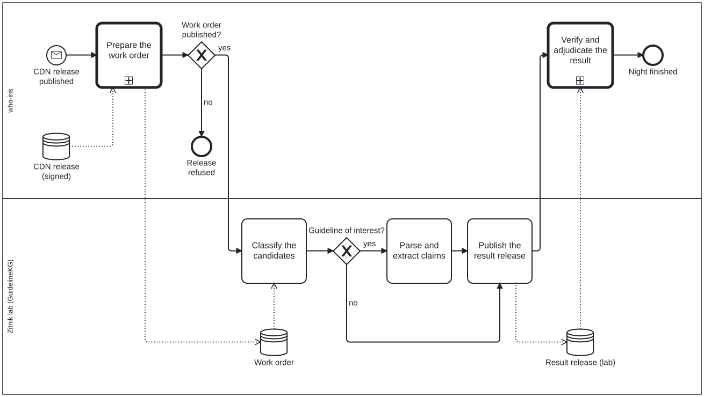
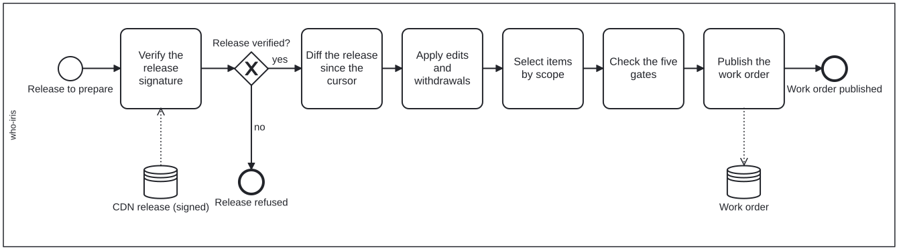
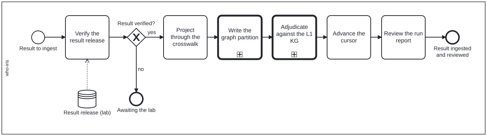
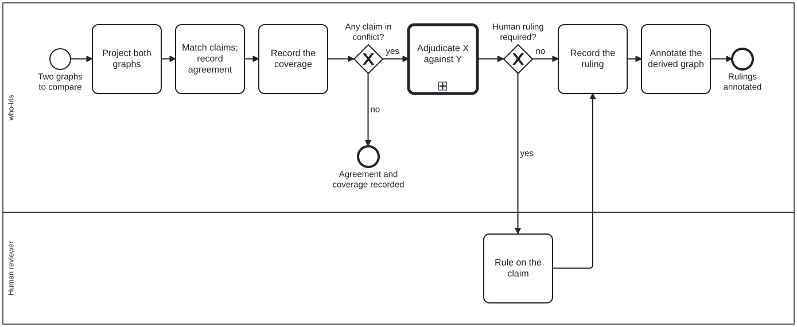

# A parallel GuidelineKG path for who-iris (Reducto + OptimusKG): design and integration options

**Status: exploration and design only.** This document adds no code, no
process files and no beans. It sets out the integration options, a
recommendation, and the questions the owner needs to answer before the work
items are opened. The existing L1 → KG ingestion is left exactly as it is: the
new path runs **beside** it and never writes the files it writes.

**Revised 2026-11-17, after the owner named the tool.** "redacto" is
**[Reducto](https://reducto.ai)**, a hosted document-parsing API. The pipeline
that uses it is **GuidelineKG**
([mims-harvard/guideline-kg](https://github.com/mims-harvard/guideline-kg),
private, MIT, from the same lab as OptimusKG). The owner: "That's what we will
use over Optimus." GuidelineKG is Tool B throughout this document, and its own
section is [3b](#3b-guidelinekg-tool-b).

**Owner answers, 2026-11-17 17:29Z** (relayed by the merge manager):

- **The Zitnik lab at Harvard runs GuidelineKG and supplies the Reducto and
  Azure OpenAI keys.** No key goes into a WHO repository, and the run happens
  on the lab's side.
- **Extraction covers all six WHO languages** (ar, en, es, fr, ru, zh), not
  English only.

Section [3c](#3c-run-by-the-lab-in-six-languages) is the design for both.

**Owner decisions, 2026-11-17 17:31Z and 17:33Z:**

- **Sending content is cleared.** "Ok to send content to Reducto and
  OpenAI": WHO IRIS PDFs may go to Reducto and text to Azure OpenAI, on the
  lab's keys. The provider terms and retention settings are the operator's
  (the lab's) to configure.
- **Licence.** "We will use [the SMART base IG's] license." This pipeline's outputs
  held by who-iris (the GuidelineKG extract, the crosswalk and the
  adjudication results) are licensed under the licence of the SMART base IG (the WHO SMART Guidelines base implementation guide).
- **The CDN source is public.** The Zitnik lab may use it however it likes,
  including privately, provided it follows the licence terms. Contributing
  the adapter to the lab's private repository is therefore fine.

Section [3d](#3d-licensing-and-data-use) records these, and the
licence-compatibility points they leave open.

**Owner decisions, 2026-11-17 (answer cards and a follow-up message):**

- **Two levels of ingestion.** "One should be basic for everything. Summary of
  what the article or PDF is about, some basic keyword extraction. Then for
  things that are L1 or L2 source documents, a deeper knowledge graph
  extraction should take place that tries to … populate what's in the L1 or
  L2 schema." See section [3e](#3e-two-levels-of-ingestion).
- **The default scope lives in the SMART base IG.** "There should be in [the SMART base IG] a
  default scope and guidance and prompting. It should be a skill there. Then
  part of creating a new document as an editor is refining scope (not
  replacing)." See section 8.
- **Both graphs stay available.** "Pipeline can produce a derived graph.
  Both are present. The GuidelineKG will be managed and maintained by the
  Harvard team and published under their repos, at least for now. Both should
  be available (selectivity) for authors of L1, L2, DAK or DTH content." See
  section 7.
- **Evidence review criteria belong to the document.** "The author/editor of
  an L1 or an L2 document should provide the review criteria for the evidence
  that went into their document, and that should be documented as part of the
  document creation. That review criteria should be actively used by the
  agents as it tries to identify evidence in the knowledge graphs and assess
  it." See section 8.
- **Examples:** keep the placeholders for now.
- **Level 1 is run by the Harvard lab, in GuidelineKG**, on the same keys.
- **The DAK target is the SMART base IG's `main` pinned at `781a8b9`**, re-pinned on
  each release.
- **Trust in GuidelineKG output:** pin a GuidelineKG commit now, and move to
  lab-signed (`did:web`) releases later.

The owner's request, 2026-11-17 (relayed, lightly edited for typos):

> need to update who-iris KG to include a new parallel KG process/tooling/skill
> set. The current L1 → KG ingestion should remain. We have a new one that makes
> use of a tool 'redacto'. It will adapt https://optimuskg.ai/ . Explore
> integration paths and document processes. Where outputs are related, we need
> to align schemas to DAK/WHO schemas. When schema aligned, then need
> adjudication to compare outputs of different tools. The ingestion process for
> the Optimus-like KG extract should pull from the nightly who-iris CDN feed to
> process new materials. As part of the new L1 guideline development process,
> the editor should describe the articles / evidence / what comprises a
> guideline of interest for that L1 document. This should be used to develop
> queries against IRIS DSpace / Dublin Core, as well as provide guidance for
> agentic review of a library KG (who-iris or external).

**Contents**

1. [Findings that shape the design](#1-findings-that-shape-the-design)
2. [The existing L1 → KG ingestion, which stays](#2-the-existing-l1--kg-ingestion-which-stays)
3. [OptimusKG: what is worth adapting](#3-optimuskg-what-is-worth-adapting)
   - [3b. GuidelineKG: Tool B](#3b-guidelinekg-tool-b)
   - [3c. Run by the lab, in six languages](#3c-run-by-the-lab-in-six-languages)
   - [3d. Licensing and data use](#3d-licensing-and-data-use)
   - [3e. Two levels of ingestion](#3e-two-levels-of-ingestion)
4. [Integration options and the recommendation](#4-integration-options-and-the-recommendation)
5. [Consuming the nightly CDN feed](#5-consuming-the-nightly-cdn-feed)
6. [Schema alignment: the crosswalk](#6-schema-alignment-the-crosswalk)
7. [Adjudication between the two tools](#7-adjudication-between-the-two-tools)
8. [The L1 editor's scope of interest](#8-the-l1-editors-scope-of-interest)
9. [The processes, as the harness expects them](#9-the-processes-as-the-harness-expects-them)
10. [Where each piece lives](#10-where-each-piece-lives)
11. [Proposed work items (beans)](#11-proposed-work-items-beans)
12. [Open questions for the owner](#12-open-questions-for-the-owner)

---

## 1. Findings that shape the design

Three findings change the request as it was written. Each one is stated first
because the rest of the design depends on it.

1. **OptimusKG does not extract a graph from documents.** It is a reproducible
   build that merges about 65 structured and semi-structured biomedical
   databases, such as Open Targets, DrugBank, CTD and Reactome, into one property graph. It has no
   chunking, no entity or relation extraction from text, and no LLM in the
   build; an LLM (PaperQA3) appears only in its *evaluation*. Its code is at
   [mims-harvard/optimuskg](https://github.com/mims-harvard/optimuskg) and
   [the lab announced it in April 2026](https://zitniklab.hms.harvard.edu/2026/04/25/OptimusKG/).
   So "adapt OptimusKG" for WHO IRIS PDFs can only mean adopting its
   **architecture, schema shape and provenance model**, with a text-extraction
   front end that OptimusKG does not have. **GuidelineKG is that front end.**
   It parses guideline PDFs with Reducto, extracts recommendation claims with
   an LLM, and writes them as an OptimusKG-shaped layer whose entities are
   OptimusKG nodes (section 3b).
2. **"redacto" is Reducto, and Tool B is GuidelineKG.** The first searches of
   the `litlfred` and `WorldHealthOrganization` organisations found nothing,
   because the tool is spelled Reducto. The owner then pointed to
   GuidelineKG, whose `src/parser/_reducto.py` wraps Reducto's **Parse**,
   **Extract** and **Classify** APIs. Reducto is a commercial cloud service, so
   every PDF it reads is sent to a third party and billed per page. The
   pipeline is idempotent per PDF hash, so a re-run is not billed again.
   Section 3b describes GuidelineKG; questions 1 and 10–13 in section 12 cover
   what using it implies.
3. **The nightly CDN feed is designed and coded, but it is not consumable
   yet.** [`processes/iris-cdn-nightly.bpmn`](../processes/iris-cdn-nightly.bpmn)
   and `scripts/iris-cdn/run.ts nightly` produce a signed BagIt release in a git
   repository on Cloudflare Artifacts, with bytes in R2. Deployment still has
   open items ([`iris-cdn-deployment.md` §Still open](iris-cdn-deployment.md#still-open)).
   The new path should depend on the feed's *contract*, the verified release
   and its payload manifest, and not on its run time. Then it can be built and
   tested against a local release before the feed is live.

A fourth point is a constraint rather than a finding. **The gap is the point**
([`AGENTS.md`](../AGENTS.md)). The nightly feed reports every IRIS change, and
IRIS has 273,559 items. The new path must not turn the feed into a bulk import.
It processes an item only when an L1 editor's scope of interest (section 8)
selects it, and only after the materialisation gates in
[`materialize-remote`](../folio-assistant-core/schemas/materialization.ts) pass.

## 2. The existing L1 → KG ingestion, which stays

The current path is folio-assistant-core's library-ingestion chain. The SMART base IG
skills then write the L1 knowledge graph from what it derives. Nothing in this
design edits these processes or the files they own.

| step | process (folio-assistant-core `processes/library/`) | what it writes under `library/<slug>/` |
|---|---|---|
| extract structure | `ingest-extract-structure.bpmn` | `sections/*.md`, `structure.json`, `candidates.json`, OCR pages |
| derive content | `ingest-derive-content.bpmn` | `images.json`, `vector-*.json`, `footnotes.json`, tabular CSVW |
| build the L1 KG | `ingest-build-l1-kg.bpmn` | `dublin-core.jsonld`, `manifest.jsonld`, assets, glossary candidates, `references/` |
| completeness gate | `ingest-l1-completeness-gate.bpmn` | the `check:l1-complete` verdict. Its round-trip and `Task_FlagDrift` adjudication are the pattern section 7 reuses |
| publish statements | `publish-extracted-statements.bpmn` | statement pages with source links |
| L1 KG (the SMART base IG) | skill `extract-smart-kg-l1` (SMART base IG) | `smart-kg-l1.json`, context `http://smart.who.int/kg/l1.context.jsonld`: nodes `publication`, `publication-section`, `recommendation`; edges are `Statement`s (`contains`), each node with `derivation` and `evidence{location, quote}` |
| L1 library KG (the SMART base IG) | skill `dak-l1-library` (SMART base IG) | `smart-kg-l1-library.jsonld`, ontology 3.0: `library-node`, `publication-section`, `publication-element`; edges `contains`, `specializationOf` |

Today three library entries carry `smart-kg-l1-library.jsonld` and two carry
`smart-kg-l1.json`. The existing path is **section-structural and
recommendation-centred**: it knows where a statement is in a publication and
that the statement is a recommendation. It does not know which disease, drug or
exposure the statement is about. That missing layer is what an OptimusKG-style
typed entity graph would add, which is why the two outputs are related but not
redundant, and why aligning them is worth the effort.

## 3. OptimusKG: what is worth adapting

Read from the repository at commit `4fb3529` (2026-09-21), its docs site
source (`docs/content/docs/`), and the PyPI client
[`optimuskg` 1.0.0](https://pypi.org/project/optimuskg/) (MIT, Python ≥ 3.12).
The client describes the graph as integrating 65 resources grounded with 18
ontologies and vocabularies, with 190,531 nodes in 10 entity types and
21,813,816 edges in 26 relation types. The repository README gives slightly
different counts (192,813 nodes, 27 edge labels), so the figures depend on the
release. The paper is cited as Vittor *et al.*, "OptimusKG: Unifying
biomedical knowledge in a modern multimodal graph", *Nature Scientific Data*,
2026, and is on arXiv as
[2604.27269](https://arxiv.org/abs/2604.27269) (v3, 2026-09-01), read through
`export.arxiv.org`. The optimuskg.ai pages on the client, MCP bundle, nodes and
edges were supplied as PDFs (captured 2026-11-17). The counts differ a little
between sources: the paper's v3 gives 190,939 nodes, 21,818,752 edges in 27
edge types and 145 property keys.

The paper states the design choice this whole document turns on: "many [KGs]
are derived from unstructured documents and therefore lack schema-level
constraints". OptimusKG is built from structured and semi-structured resources
*instead*, so its schema discipline is what to adopt for a WHO extractor. It is
not a model of how to extract.

| aspect | OptimusKG | adopt for the WHO path? |
|---|---|---|
| layers | Kedro "medallion": `landing → bronze → silver → gold`, pure-function nodes in DAG pipelines, a dataset catalog that is the single source of truth for each schema | **Yes, the shape.** `landing` = verified CDN bytes; `bronze` = Tool B's raw output; `silver` = grounded and normalised; `gold` = aligned to the WHO crosswalk, ready to adjudicate |
| determinism | version-pinned providers, checksum and quality-check hooks, reproducible runs | **Yes.** It matches the CDN's no-churn rule: same input, same bytes |
| grounding | BioCypher + Biolink Model; MONDO, DO, HPO, GO, Orphanet, UBERON; UMLS CUIs kept as properties; CURIE ids | **Partly.** Keep the BioCypher schema-config approach. Ground to **WHO vocabularies first** (ICD-11, ATC/INN, MeSH as IRIS already carries it, the WHO glossary), with Biolink and MONDO as `skos:closeMatch` bridges |
| node types | 10, each a 3-letter label: GEN 61,306, DIS 36,753, BPO 25,754, PHE 19,341, DRG 18,640, ANA 13,120, MFN 10,161, CCO 4,052, PWY 2,805, EXP 881. Ids are CURIEs: Disease `MONDO:`, Drug DrugBank `DB…`, Exposure `CTD:D…` (a MeSH descriptor), Gene Ensembl | **Subset.** Drug, Disease, Phenotype, Exposure and Anatomy matter for WHO guidance. The molecular types are out of scope unless a scope of interest asks for them |
| edge shape | `from, to, label, relation, undirected, properties`; at most one edge per `(from, to, label)` | **Yes**, plus a mandatory evidence locator (section 6) |
| provenance | `sources{direct[], indirect[]}` on every node and edge; `evidence_score/count/index` on associations | **Yes**, with `direct` = the IRIS handle + section + page + quote |
| conflict model | `relation_assertions` keeps every `{source, relation}`; `relation_conflict` flags mutually exclusive ones. The current release keeps 3,826 source assertions that a priority-only collapse would drop, including 339 drug–disease pairs that are both INDICATION and CONTRAINDICATION. Its own docs warn: "For clinical or safety-sensitive analyses, read `relation_assertions` rather than `relation` alone, and treat `relation_conflict = true` edges as requiring source-level review" | **Yes. This is the seed of the adjudication input.** It records disagreement *inside* one tool; section 7 extends it to disagreement *between* tools |
| outputs | The Parquet gold layer on Harvard Dataverse (about 280 MB): `nodes.parquet`, `edges.parquet`, the largest-connected-component versions, and per-type `nodes/<type>.parquet` and `edges/<label>.parquet`. There is also a Neo4j export. The PyPI client `optimuskg` downloads and caches gold files (`get_file`, `load_parquet`, `load_graph(lcc=True)`, `load_networkx`). Its cache is keyed `<doi_slug>/<dataset_version>/<path>` and it is pinned by `OPTIMUSKG_DOI` / `OPTIMUSKG_SERVER`. An `.mcpb` MCP bundle builds a 2.54 GB local DuckDB and exposes `list_schema`, `search_entities`, `get_entity`, `get_neighbors`, `count_neighbors`, `find_connection` and a read-only `run_sql`. An agent skill is published (`npx skills add https://github.com/mims-harvard/optimuskg --skill optimuskg`). There is **no RDF** | **Parquet as the working form**, then projected to N-Quads so the existing Oxigraph partitions ([`iris-oxigraph`](../skills/iris-oxigraph.md)) can query both graphs side by side |
| evaluation | PaperQA3 scored literature support from 1 to 5 for 4,708 true edges and 1,000 false edges. The edges came from 100 seed nodes per type, with the top and bottom 10% by degree left out and up to 10 neighbours per seed. 70.0% of true edges had literature support and 83.4% of false edges had none. Unsupported true edges were mostly ANA–GEN, DIS–GEN and DRG–DRG, which come from primary experimental data | **Yes, as the sampling plan** for the agentic adjudication in section 7 |
| licence | code and client MIT (© 2025 Zitnik Lab). The **graph is CC BY-NC-SA 4.0** on Harvard Dataverse (`doi:10.7910/DVN/IYNGEV`), per the paper's data-availability statement. On top of that, each source keeps its own licence: Open Targets CC0, DrugCentral CC BY-SA 4.0, CTD non-commercial | Adapting the **code patterns** is clear under MIT. **Using the data is not**: NonCommercial and ShareAlike both apply to anything derived from it, so option D needs a legal ruling (section 12, Q5) |

## 3b. GuidelineKG: Tool B

Read from `mims-harvard/guideline-kg` at `159514a` (2026-07-09; the repository
was last pushed 2026-08-28). The repository is private, licensed MIT, version
`0.0.1`, Python 3.13. Its README describes it as "a multimodal biomedical
knowledge graph enriched with clinical guidelines".

**The pipeline is five CLI stages, joined by `id` / `version` / `sha256`:**

| stage | what it does | external service | output |
|---|---|---|---|
| `scraper` | 25 sources, `who` among them. The `who` scraper calls the IRIS DSpace 7 REST API (`/server/api/discover/search/objects`, `embed=bundles/bitstreams`, newest first, at most 200 × 25 items). `who-seed` targets a list of **1,161 WHO IRIS seeds** (ISBN or title) taken from an earlier "PV database". **English only**: an item whose `dc.language.iso` is not English is skipped | IRIS | `data/guidelines/who/*.pdf` + `metadata.json`: `id`, `version`, `supersedes`, `sha256`, `source_url`, `page_count`, `title`, `publication_date`, `topic`, `language`, `extra{iris_item_uuid, bitstream_uuid}` |
| `classifier` | single-label document type from the first ≤ 10 pages, in three groups. **A**, guideline family: clinical practice guideline, consensus statement, recommendation statement, guidance/advisory, guideline derivative, evidence report. **B**, other normative documents. **C**, informational. Which classes to keep is deliberately left undecided (`keep_categories: null`) | Reducto Classify | `data/classified/who/classify_index.json` |
| `parser` | a typed block tree (`heading`, `paragraph`, `list_item`, `table`, `figure`), each block with page, bbox and OCR confidence, plus guideline metadata (title, date, organisation, region, description) | Reducto Parse + Extract | `data/parsed/who/<slug>/{parse.json, document.md, metadata.json}` |
| `linker` | grounds a mention to an OptimusKG CURIE: embed it with `text-embedding-3-large`, take the cosine top *j* over a prebuilt index of about 190k OptimusKG nodes, and let an LLM choose | OpenAI embeddings, Azure OpenAI, the `optimuskg` client | the vector index |
| `integration` | an LLM extracts the guideline's **own recommendations** per paragraph as `(subject, predicate, object, optimus_relation, population, action)`. The prompt excludes evidence descriptions, economics, committee process and implementation logistics. Each entity is linked, and the result is written as a layer over OptimusKG | Azure OpenAI (JSON mode) | `data/graph/guideline_kg.jsonl` |

**Its schema** (`src/integration/schema.py`) is the important part for this
design:

- **Content tree.** Every id is minted under `guideline:`:
  `Guideline -HAS_SECTION-> Section -HAS_PARAGRAPH-> Paragraph -HAS_CLAIM-> Claim`,
  and `Guideline -HAS_FIGURE/HAS_TABLE->`.
  - `Guideline` carries name, publication_date, organization, region, description and length.
  - `Section` carries heading and page_range.
  - `Paragraph` carries text, page, bbox and ocr_confidence.
  - `Claim` carries text, subject, predicate, object, status, asserted_in, last_affirmed and retracted_in.
- **Grounding edges.** `MENTIONS`, `DEPICTS` and `TABULATES` run from a
  content node to an OptimusKG CURIE. Each has text_span, char_start/char_end,
  page, section_id, ocr_confidence and entity_linking_confidence.
- **Assertion edges.** These run from one OptimusKG CURIE to another and are
  shaped exactly like an OptimusKG edge: `label` is the node pair (`DRG-DIS`)
  and `relation` is the native relation (`INDICATION`, `CONTRAINDICATION`,
  `OFF_LABEL_USE`, `ADVERSE_DRUG_REACTION`, `ASSOCIATED_WITH`,
  `SYNERGISTIC_INTERACTION`, `LINKED_TO`). Their properties are nature,
  population, claim_id, status, asserted_in, last_affirmed and retracted_in.
- **Ids are content-addressed.** A claim's id hashes its grounded
  `(subject CURIE, relation, object CURIE, population)`, so it is stable when
  the text is reworded and across guideline versions. The store keys edges by
  `(from, to, relation)`, so an INDICATION and a CONTRAINDICATION on the same
  pair stay separate. **Retraction and supersession are modelled.**
- **Validation.** `integration validate --check-references` checks every
  CURIE endpoint against the OptimusKG node set.

**What this changes in the design:**

1. **The two outputs line up structurally.** `Guideline / Section / Claim`
   maps almost one for one onto the L1 KG's
   `publication / publication-section / recommendation`. GuidelineKG adds what
   the L1 KG lacks: grounded entities and typed assertions. The crosswalk in
   section 6 now has a concrete source schema.
2. **It already reads WHO IRIS, but by crawling it.** The `who` scraper is a
   second, unsigned and English-only route into IRIS. The integration point is
   to **replace that discovery with the verified CDN feed** (section 5). All
   downstream stages key on the PDF's `sha256`, and so does the CDN, so
   nothing else changes. `extra.iris_item_uuid` is the DSpace UUID, which
   joins GuidelineKG records to the who-iris catalogue.
3. **OptimusKG becomes a dependency, not an option.** The linker's index is
   built from OptimusKG nodes, and every grounded edge points at an OptimusKG
   CURIE. OptimusKG's data licence (CC BY-NC-SA 4.0) therefore bears on
   GuidelineKG's output (section 12, Q5).
4. **Its scope is narrower than an L1 document's.** The claim prompt keeps
   recommendations and drops descriptions of the evidence. A WHO L1 also needs
   the evidence and its certainty (GRADE). That part stays with the existing
   L1 path, and comparison is limited to recommendations (section 7).
5. **Its document classifier is a ready vocabulary for the L1 editor's
   "evidence types" and "guideline of interest"** (section 8).

## 3c. Run by the lab, in six languages

### Who runs what, and where the keys are

The owner's ruling puts the boundary between the two organisations, and that
boundary decides the interfaces:

| side | holds | does |
|---|---|---|
| **who-iris** (WHO) | no Reducto, OpenAI or Azure key, ever | publishes the signed CDN release (as today); publishes a **work order** per night: the scope-selected handles with their bitstream digests and `dc.language.iso`; verifies and adjudicates what comes back |
| **GuidelineKG** (Zitnik lab) | the Reducto and Azure OpenAI keys, in the lab's own secret store | reads the work order and the public CDN release, **verifies the release JWS against WHO's `did:web` key before reading a byte**, runs classify → parse → integrate, and publishes a **result release** |
| **the result release** | — | `guideline_kg.jsonl` plus a manifest of SHA-256 digests, naming the work order, the CDN release and the GuidelineKG commit it was computed from. **For now who-iris trusts it by the pinned GuidelineKG commit and the digests** (owner, decided). Later the lab signs it with a key published as its own `did:web`, so who-iris checks it the way anyone checks a WHO release |

who-iris never calls Reducto or OpenAI and never needs network access to them.
The lab is its own lane in section 9, **Zitnik lab (GuidelineKG)**, bound to
an `external` role, and the only things that cross into it are two data
stores: the *work order* who-iris writes and the *result release* the lab
writes. A night on which the lab publishes nothing is a state the
run report shows (`awaiting-extractor`). It is not a failure, and it never
blocks the CDN release.

The **work order** is the only new public artefact on the WHO side. It goes in
the CDN release history as `state/guidelinekg/work-order.json` beside
`state/cursor.json`. It is canonical JSON and changes only when the selection
changes, which keeps the no-churn rule.

### Six languages

IRIS publishes most translations **as separate items**, each with its own
`dc.language.iso`, ISBN and Handle. GuidelineKG's own `who.py` says so. Some
items instead carry several language bitstreams. The design treats a
*language version* as the unit and links versions into one *work*:

1. **Language comes from the record, and detection checks it.**
   `dc.language.iso` from `records/<handle>.json` is authoritative. Script
   detection on the parsed text, like GuidelineKG's `relang`, only checks it.
   A mismatch is a finding, never a silent relabel. A multi-language item is
   split per bitstream, and each bitstream's language comes from its file name
   or its detected script, recorded as `inferred`.
2. **Parse per language.** Reducto parses each language version on its own,
   with the language passed as a hint where its API takes one. Whether Reducto's
   OCR and layout quality holds for Arabic (right-to-left) and Chinese is
   **not verified**. The baseline (bean 9) must measure it per language before
   any threshold is set.
3. **Extract claims in the source language.** The claim prompt is run on the
   paragraph in its own language. `optimus_relation` is a controlled,
   language-free vocabulary, so the *assertion* is comparable across
   languages, while `text`, `subject`, `object` and `population` stay
   verbatim in the source language. No machine translation sits in the
   evidence chain. A translated gloss, if one is added, is a separate field
   marked `inferred`.
4. **Link entities across languages.** The linker's index embeds OptimusKG
   names and synonyms, which are almost all English. A multilingual embedding
   gives some cross-lingual recall, but it is not enough to rely on. Add
   **WHO's own multilingual labels** to the index:
   - ICD-11 titles, which ICD-11 publishes in the UN languages;
   - INN names;
   - the who-iris glossary's translations (`translations/`).

   Each label is attached to the OptimusKG CURIE it maps to through the
   crosswalk. Every grounding records the label language it matched on, and a
   cross-language match carries a lower prior confidence until the baseline
   calibrates it.
5. **Match the same guideline across languages.** The match uses, in order of
   evidence:
   1. an IRIS relation field linking the items (`dc.relation.*`, if IRIS fills
      it; **not verified**);
   2. a shared govdoc number or series identifier (`dc.identifier.govdoc`);
   3. the who-iris catalogue's own grouping, if it records one;
   4. last, a high overlap of language-free assertion keys
      `(subject CURIE, relation, object CURIE)` between two items, recorded as
      `inferred`.

   The result is a `work` node with `hasTranslation` edges, owned by who-iris
   rather than GuidelineKG, because it is a fact about the IRIS corpus.
6. **Adjudicate like with like.** Tool comparison (section 7) always compares
   L1 KG and GuidelineKG on the **same language version**. Comparing claims
   across languages is a **different check**: a claim present in the English
   version and missing from the French one is a translation-consistency
   finding. It goes to the existing round-trip translation QA lane
   (`ingest-l1-completeness-gate` `Task_RoundTrip` / `Task_FlagDrift`), not to
   tool adjudication. It is a disagreement between documents, not between
   tools.
7. **Population becomes part of the language-free key.** GuidelineKG puts
   free-text `population` into the claim id, so "pregnant women" and
   "femmes enceintes" would mint two different claims. The comparison form
   normalises population to a code where one exists, for example an age, sex
   or pregnancy category from the DAK's core data elements, and keeps the
   verbatim text beside it. Only the code enters the cross-language key.

### What GuidelineKG would need to change

Read at `159514a`. Each item is a proposal for the lab, and none is a change
who-iris makes:

| where | today | needed |
|---|---|---|
| `src/scraper/sources/who.py` | skips any item whose `dc.language.iso` is not English | the `who-iris-cdn` source takes all six languages and records `language` from the record |
| `src/scraper/prune.py`, `cli scraper prune-non-english` | enforces "English-only corpus by policy" | do not run it on WHO sources; or make the policy a per-source setting |
| `src/scraper/figures.py`, `--english-only` | English is the headline language | report per language (needed for the per-language baseline) |
| `conf/who_iris_seeds.json` (1,161 seeds) | ISBN/title seeds from an English `-eng.pdf` archive; title matching is ASCII-normalised | seeds come from the who-iris work order by Handle/UUID; no title matching needed |
| `src/scraper/utils.py` `slugify` | NFKD → ASCII, so Arabic, Chinese and Russian titles all slug to `guideline` | harmless for file names, which also carry the hex id. Do not use the title slug as an identity anywhere |
| `src/integration/schema.py` `slugify` (`[^a-z0-9]`) | the ad-hoc path (`pipeline.py` without a slug) turns a non-Latin title into `untitled`, so `guideline:untitled` would collide | always pass the record's hex id or the IRIS Handle as the slug. The batch runner already passes `record.guideline_id` |
| `src/integration/claims.py` prompt | English instructions, English examples, and an English guideline subject | state that the paragraph may be in any of the six languages; extract verbatim in the source language; keep `optimus_relation` from the fixed list |
| `src/linker/*` index | OptimusKG names and synonyms (English) | add the WHO multilingual labels (ICD-11, INN, glossary translations) per CURIE, and record the matched label's language |
| `src/integration/schema.py` claim id | hashes free-text `population` | add a normalised population code, and use it in the key when present |
| claim provenance | no language field on `Claim` / `Paragraph` | add `language` (from the record) on `Guideline` and propagate it to `Paragraph` and `Claim` |

## 3d. Licensing and data use

### Decided

| what | decision | basis |
|---|---|---|
| sending IRIS PDFs to Reducto, and text to Azure OpenAI / OpenAI embeddings | **permitted**, on the lab's keys | owner, 17:31Z. **The lab, as operator, configures the provider terms and retention** (for example zero-retention or no-training settings). who-iris records which settings applied to a run only if the result release declares them |
| licence of this pipeline's outputs held by who-iris | **the SMART base IG's licence** | owner, 17:33Z |
| the CDN source adapter | public; the lab may use it however it likes, including privately, provided it follows the licence terms | owner, 17:33Z |

the SMART base IG's licence, quoted exactly from `LICENSE.md` at
the SMART base IG's repository at `781a8b9` (2026-10-20), first line:

> # Creative Commons Attribution 3.0 IGO (CC-BY-3.0-IGO)

and its licence-text paragraph:

> This work is licensed under the [Creative Commons Attribution 3.0 IGO (CC-BY-3.0-IGO) License](https://creativecommons.org/licenses/by/3.0/igo/).

So "cc-igo" is **CC BY 3.0 IGO**. It is the attribution-only variant, with no
NonCommercial and no ShareAlike. Its summary says it permits adaptation "for
any purpose, even commercially".

### Licence-compatibility points that remain (flagged, not resolved)

These are points for WHO's legal office, not for this design to settle.

1. **OptimusKG inputs are CC BY-NC-SA 4.0.** Both NonCommercial and
   ShareAlike conflict with relicensing anything *adapted from* OptimusKG
   under CC BY 3.0 IGO. The question is what in the outputs is adapted from
   OptimusKG:
   - GuidelineKG's assertion edges are extracted from **WHO text**. They
     carry OptimusKG **CURIEs** (identifiers) as endpoints, and are grounded
     with an index built from OptimusKG names and synonyms.
   - **Proposed handling, pending a ruling:** who-iris outputs carry only
     the CURIEs plus WHO-derived content (claims, quotes, locators,
     adjudication). They never copy OptimusKG labels, synonyms, properties or
     edges. Anything taken from OptimusKG itself stays `referenced`, under
     its own licence, and is never materialised into a CC BY 3.0 IGO output.
     Whether a CURIE plus the act of linking is an adaptation is the legal
     question.
   - This also bears on option D. Using OptimusKG's own edges as a
     comparison reference is fine as long as they are **not copied** into an
     output.
2. **Many IRIS items are themselves CC BY-NC-SA 3.0 IGO.** Of the 222
   catalogue records here, 78 carry `dc.rights` =
   `CC BY-NC-SA 3.0 IGO` with `dc.rights.holder` = `World Health Organization`.
   The rest record no `dc.rights`, which is `unknown`, not permitted.
   - Verbatim claim text, quotes and section text extracted from those
     items are adaptations of NC-SA works.
   - **WHO is the rights holder**, so WHO can license its own adaptations
     differently, but only for material WHO holds the rights to. That covers
     neither a co-published item with a different holder, nor the lab's own
     contribution as the party that made the extract.
   - **The point to confirm:** whether the lab's outputs are produced for
     WHO, or assigned or licensed to WHO, so that WHO can license them under
     CC BY 3.0 IGO.
3. **Which licence the lab must follow when it uses the CDN source.** The
   owner says the lab may use the CDN source "as long as they follow the
   licence terms". Two licences are in play:
   - the adapter **code** lands in GuidelineKG, which is MIT;
   - the CDN **content** carries each IRIS item's own `dc.rights`.

   who-iris itself has **no LICENSE file**. Stating the who-iris licence, for
   the adapter and for the CDN's derived files such as the catalogue records,
   would make "the licence terms" checkable.

## 3e. Two levels of ingestion

| | **Level 1, basic** | **Level 2, deep** |
|---|---|---|
| applies to | **every** IRIS item the nightly feed reports, in all six languages | items that are **L1 or L2 source documents**, as selected by an editor's scope (section 8) |
| produces | a short summary of what the item is about, plus keywords | a knowledge-graph extraction that **populates the L1 schema** (the SMART base IG `kg/l1`: publication, section, recommendation and the typed entities of section 6) **or the L2 schema** (the DAK components and logical models) |
| input | IRIS metadata (`dc.description.abstract`, `dc.subject`, `dc.subject.mesh`), plus the first pages when the abstract is missing | the full document (GuidelineKG classify → parse → claims → linking), plus the existing L1 path |
| size held | small per item: a summary, a keyword list and their provenance. Held as a catalogue-level annotation, so the corpus **shape** gains a description without the corpus being held | as before: by reference, `materialized` only for scoped items that pass the five gates |
| runs | **the Harvard lab, in GuidelineKG** (owner, decided): a cheap first-pages pass, Reducto Classify plus a short LLM summary | the Zitnik lab (GuidelineKG), and the existing L1 path in parallel |

Level 1 does not contradict "the gap is the point". It adds a description
to every node the catalogue models. It does not hold the items. Its keywords
also feed level 2's selection: an item whose summary or keywords match an
active scope becomes a candidate for deep extraction.

Level 1 must declare its own provenance. A summary is a claim by someone
(`ingest-derive-content` `Task_Provenance`), so each summary records the
model, prompt version, input pages and language. who-iris's existing
`summaries.json` for held entries is the same kind of artefact, and the two
must not overwrite each other.

## 4. Integration options and the recommendation

All four options keep the existing path untouched, and all four consume the
same CDN contract. They differ in where Tool B runs and where its output lives.

| | option | how | for | against |
|---|---|---|---|---|
| **A** | Sibling pipeline in who-iris | IRIS-specific scripts in `scripts/optimus/`; outputs under a new declared directory, e.g. `kg-optimus/<slug>/{bronze,silver,gold}/` | One repository, same CI, same mounts | who-iris is `separation: content` and tolerates IRIS-specific code only with a QA warning. A Kedro/Python extractor is far more than "a small number of tools" (owner, 2026-10-01) |
| **B** | A step inside `ingest-build-l1-kg` | a new task after `Task_Link` | No new process | **Rejected.** It is not parallel: it changes the process the owner said must remain, and it couples Tool B's failures to L1 completeness |
| **C** | External extractor, referenced KG | GuidelineKG runs from its own repository, pinned by commit. A small **CDN source** in GuidelineKG replaces its IRIS crawl for WHO items. who-iris holds only orchestration, the crosswalk and adjudication records, and references `guideline_kg.jsonl` by digest | Clean split: code where code belongs; the gold output is a **remote KG** in the materialisation sense, so its subgraph metadata sits under `library/<source>/` | Two release trains to pin and keep in step |
| **D** | Import OptimusKG's own graph as an external library KG | subscribe to one Dataverse release as a remote KG, read through the `optimuskg` client pinned by `OPTIMUSKG_DOI`; only the node and edge files a scope needs (e.g. `nodes/drug.parquet`, `nodes/disease.parquet` and the DRG–DIS edges) are fetched, and their metadata is held under `library/optimuskg/`; no extraction | Gives drug–disease grounding at once. The published MCP bundle (`search_entities`, `get_neighbors`, `find_connection`) is a ready-made interface for section 8's agentic review of an external library KG | Biomedical-database facts, not WHO guidance. **The data is CC BY-NC-SA 4.0**, and some sources carry stricter terms. GuidelineKG's linker needs OptimusKG regardless (section 3b), so the licence ruling is needed either way |

**Recommendation: C for the extractor runtime, with A's thin orchestration
layer in who-iris.** The parts are placed in section 10.

- who-iris holds the IRIS-specific **feed consumer**, the **processes**, the
  **skills** and the **crosswalk data**. These are small and IRIS-specific, so
  they fit the owner's 2026-10-09 ruling: "iris specific tools need to be in
  litlfred/who-iris".
- **GuidelineKG** stays in `mims-harvard/guideline-kg`, pinned by commit, and
  **the lab runs it with its own keys** (section 3c). who-iris publishes a
  work order and verifies a signed result release. It needs one addition
  there: a `who-iris-cdn` source beside its `who` scraper, which reads the
  work order, plus the multilingual changes listed in 3c. The source writes the same `data/guidelines/who/metadata.json`
  records from a verified CDN release instead of crawling IRIS, putting the
  IRIS Handle and UUID in `extra`. `classifier`, `parser`, `linker` and
  `integration` then run unchanged. That is a PR to a repository who-iris
  does not own (section 12, Q11).
- The **graph output** (`guideline_kg.jsonl`) is held by reference,
  `referenced` by default. A document's slice is `materialized` only where a
  scope of interest selected it and the five gates passed.
- **D is no longer optional in substance.** GuidelineKG cannot link without
  OptimusKG. What stays optional is using OptimusKG's own edges as a
  *comparison* reference in agentic review.

## 5. Consuming the nightly CDN feed

What the feed produces (from `scripts/iris-cdn/run.ts` and
[`iris-cdn-exporter`](../skills/iris-cdn-exporter.md)):

- a **release** is a commit in the release-history git repository on
  Cloudflare Artifacts: BagIt `bagit.txt`, date-free `bag-info.txt`,
  `manifest-sha256.txt`, `tagmanifest-sha256.txt` and its detached JWS
  `tagmanifest-sha256.txt.jws` (ES256; key from `did:web`);
- the payload manifest maps logical paths to SHA-256 digests:
  `records/<handle>.json` (the canonical DC record), `bitstreams/<handle>/<bundle>/<name>`,
  `graph/<partition>`, and per-item `items/<handle>/manifest-sha256.txt(.jws)`;
- bytes are in R2 under `sha256/<aa>/<digest>`;
- `state/cursor.json` is the exporter's own cursor. The new path never moves it.

How the new path consumes it, as process `optimus-kg-nightly` (section 9):

1. **Start after the exporter's `End_Done`**, as a message start event. A
   scheduled timer at 04:00 UTC is the fallback. A night with `End_NoChange`
   never starts it.
2. **Verify before reading.** Resolve the key from the DID document and verify
   `tagmanifest-sha256.txt.jws` (the `iris-cdn-signing` verifier: "Resolves the
   key from the DID document, never from the package"). An unverified release
   is refused. That is a state, not an error to retry.
3. **Diff against its own cursor**, `state/optimus-cursor.json`: the release
   commit and tag-manifest digest it last finished. Use `diffManifests` from
   `scripts/iris-cdn/bag.ts` to get `added`, `changed` and `removed` paths.
4. **Classify each changed handle.**
   - Only `records/<handle>.json` changed (a metadata edit): re-ground the
     publication node only. **Do not re-extract**, because the PDF digest did
     not change (the exporter's "metadata changes and the PDF does not" rule).
   - A bitstream in `ORIGINAL` changed: a candidate for extraction.
   - `removed`, or marked withdrawn by the weekly reconciliation: mark the
     derived nodes and edges `withdrawn`. Keep them addressable and never
     delete them, mirroring the reconciliation.
5. **Level 1 for every changed item; select for level 2.** Every changed
   item gets the basic summary and keywords (section 3e). Then each record's
   DC fields, summary and keywords are tested against every *active* scope of
   interest (section 8). Only an L1 or L2 source document that a scope
   selects goes on to deep extraction, and the run report counts the rest.
6. **Gate.** Check `materialize-remote`'s five gates (size, restrictions,
   retention, sourceLoss, copyright) for each selected bitstream.
   `restrictions: unknown` stays `unknown` and is never `permitted`.
7. **Publish the work order; the lab runs GuidelineKG over the landing
   bytes** (section 3c). The lab fetches them from R2 by digest and checks
   them against the digest. Its `who-iris-cdn` source writes the scraper
   record, and then `classifier classify`, `parser parse` and
   `integration build` run as they do today. The work is keyed by **bitstream
   SHA-256 plus GuidelineKG commit plus crosswalk version**. GuidelineKG
   already skips any PDF whose hash has an `ok` record, so Reducto is never
   billed twice for the same bytes. Classification runs **before** parsing:
   a document the scope does not count as a guideline of interest is
   never parsed. who-iris then **verifies the lab's result release**
   (signature, digests, and that it names this night's work order and CDN
   release) before reading it.
8. **Project `guideline_kg.jsonl` through the crosswalk** (section 6) into the
   comparison form, then into N-Quads in its own named-graph partition, e.g.
   `graph/guidelinekg/<handle>`, beside the existing partitions.
9. **Hand off to adjudication** (section 7) for every document that also has
   an L1 KG.
10. **Advance the cursor only when the run completes.** Review the run report
    and open beans for anomalies, as `Task_Review` in the exporter does.

## 6. Schema alignment: the crosswalk

Both tools are projected to one **comparison form** before they are compared:

```
(subject IRI, predicate IRI, object IRI | literal,
 evidence: { handle, uuid?, section id, page range, quote },
 derivation: derived | inferred | extracted, tool, tool version)
```

**WHO identifiers come first.** The publication is always the IRIS item (Handle
`10665/…`, DSpace UUID, ISBN or govdoc). Entities are grounded to a WHO-owned
or WHO-used scheme where one exists. Other schemes link by `skos:exactMatch`
or `skos:closeMatch`, never by replacing the WHO identifier.

### Node types

The DAK component names below are the nine components of a SMART Guidelines
Digital Adaptation Kit. The SMART base IG **logical-model names** are given as
*targets to confirm*: the SMART base IG is not mounted in this checkout, so they are
not verified against its pinned version (section 12, Q6).

| GuidelineKG (Tool B) | existing L1 KG (the SMART base IG `kg/l1`) | DAK component / WHO schema target | WHO grounding (primary) | bridge |
|---|---|---|---|---|
| `Guideline` (`guideline:<slug>`; `extra.iris_item_uuid`) | `publication` | DAK L1 source; IRIS DC record | Handle, DSpace UUID, ISBN (from `records/<handle>.json`). The join is on the **DSpace UUID**, never the slug | `dcterms:` |
| `Section` (heading, page_range), `Paragraph` (text, page, bbox), `Figure`, `Table` | `publication-section`, `publication-element` | location in L1 | section id + page range. Sections are matched by normalised heading and page overlap, because the two tools split sections differently | — |
| `Claim` (+ its assertion edge) | `recommendation` | **Component 2 — Health interventions and recommendations** (the SMART base IG recommendation / health-intervention model) | the recommendation's own IRI | GRADE certainty and strength as properties |
| Disease (DIS) | — *(gap: propose `condition`)* | Component 2 (condition targeted); Component 5 decision-support logic inputs | **ICD-11 MMS** URI | id `MONDO:`; `xrefs` carry **ICD-10** (not ICD-11), OMIM and others, plus `umls_cui`. ICD-11 is reached through WHO's ICD-10→ICD-11 mapping tables, and an unmapped code stays `unknown` |
| Phenotype (PHE) | — *(gap: propose `finding`)* | **Component 5 — Core data elements** (observation) | ICD-11 signs/symptoms chapter | HPO |
| Drug (DRG) | — *(gap: propose `product`)* | Component 5 data elements (medication); WHO **EML** | **ATC** code + **INN** | id DrugBank `DB…`. The node schema has **no ATC or INN field** (it has synonyms, trade names, UNII, CAS and a MeSH `mrdef`), but the DRG–DIS edges list ATC and INN among their indirect sources. Mapping to ATC/INN is a separate grounding step |
| Exposure (EXP) | — *(gap)* | Component 5 data elements (risk factor) | ICD-11 extension codes where one exists | id `CTD:D…` **is a MeSH descriptor**, so it joins directly to IRIS's `dc.subject.mesh`. That is the cheapest bridge between the two graphs |
| Anatomy (ANA) | — | Component 5 (body site) | ICD-11 anatomy extension | UBERON |
| Gene, Pathway, BP/CC/MF | — | out of scope unless a scope of interest asks | — | keep `referenced` |
| term label / synonym | glossary candidate (`folio-glossary/v1`, SKOS) | WHO glossary ([`glossary/`](../glossary/)) | `skos:prefLabel`, notation | `skos:altLabel` |
| — | — | Components 1 (personas), 3 (user scenarios), 4 (business processes), 6 (indicators), 7 (requirements), 8 (test scenarios) | not produced by either tool | the L1 editor and DAK authoring |

The "gap" rows are a **proposal to the SMART base IG**: add typed entity nodes to the
`kg/l1` ontology so a recommendation can be `about` a condition, product or
finding. Until the SMART base IG adopts this, the gold output carries these as its own
`who-iris` types, with `skos:closeMatch` to the Biolink class. **who-iris does
not extend the SMART base IG's ontology on its own.**

### Edges and properties

| GuidelineKG / OptimusKG | L1 KG / DAK target | note |
|---|---|---|
| `MENTIONS` / `DEPICTS` / `TABULATES` (text_span, char offsets, page, section_id, entity_linking_confidence) | `evidence{location, quote}` on the entity | the locator the gold layer requires. A grounding below a confidence floor is kept and marked `unknown`, never dropped |
| assertion `population` | the recommendation's population (PICO P) | **part of the claim's identity** in GuidelineKG, so it must be part of the match key in section 7 |
| `Claim.status` / `retracted_in` / `asserted_in` / `last_affirmed` | `dc.relation.isreplacedby` chain; catalogue `withdrawn` | across versions, a retraction in GuidelineKG and a supersession in IRIS should agree; a disagreement is a finding |
| DRG–DIS `INDICATION` | `recommendation` `recommends` (intervention for condition), strength and certainty if stated | a guideline's recommendation is not a database indication: same pair, different claim. The comparison matches the **pair**, and the predicate difference is a *kind* finding, not a conflict |
| DRG–DIS `CONTRAINDICATION` | `recommendation` with negative direction ("do not use") | |
| DRG–DIS `OFF_LABEL_USE` | no target | WHO guidance seldom states it; record and do not compare |
| DIS–PHE, DIS–EXP associations | Component 5 data-element relations | compare only within a scope that asks for them |
| `sources.direct` | `evidence{location, quote}` + `wasDerivedFrom` | must resolve to the IRIS handle and a section; **an edge without a locator is invalid in gold**, the same "no default" rule as catalogue state |
| `evidence_score`, `evidence_count` | none in L1 | kept as Tool B properties; never mapped to GRADE certainty |
| `relation_assertions`, `relation_conflict` | `block-qa` entries (section 7) | intra-tool disagreement is surfaced, not resolved by `RELATION_PRIORITY` |
| `contains` (L1) | — | structural; Tool B does not produce it. Not compared |

The crosswalk itself is **data** (`crosswalk/optimus-l1-dak.json`, versioned),
not code. Its version is part of the derivation key (section 5, step 7), so a
crosswalk change re-projects gold without re-running Tool B.

## 7. Adjudication between the two tools

**Decided by the owner: both graphs are present, and the pipeline also
produces a derived graph.**

| graph | maintained by | where it lives |
|---|---|---|
| the L1 KG (existing path) | who-iris and the SMART base IG | `library/<slug>/smart-kg-l1*.json*` |
| GuidelineKG | **the Harvard team**, "at least for now" | **published in the lab's own repositories**; who-iris references a pinned release, never a copy |
| the **derived graph** | who-iris | the comparison form of section 6, with every claim annotated with **which graphs assert it, how far they agree, and any ruling** |

Authors of L1, L2, DAK and DTH content **select** from these: one graph, the
other, or the derived graph filtered by agreement level ("selectivity"). So
the aim is **not** to pick a single winner and delete the loser. Comparison
annotates, and a ruling records a judgement *for* an author's use without
removing either source. The adjudication below is the mechanism for those
judgements. It runs where an author or reviewer needs a disputed claim
settled, and as the sampled quality measure described below.

This reuses the harness's adjudication and does not invent another.

- **The entry condition is the harness's own**
  ([`adjudication`](../cat-harness/skills/process/process-core/adjudication.md)):
  *mechanical agreement* (the comparison script passes), *consensus* (both
  tools agree), and *adjudicable* (the two tools disagree on **one** claim).
  **A claim only one tool made is not a disagreement.** It is a coverage
  finding, reported but never adjudicated, as the skill says: "A missing entry
  is not a disagreement."
- **The parties are dispatched untainted**
  ([`untainted-verification`](../cat-harness/skills/process/process-core/untainted-verification.md)).
  The adjudicator sees the source passage (the quote and section, read from the
  library entry) and the two claims **anonymised as X and Y**, never which tool
  made which. It uses no tools and says so (`tools_used`). It never sees either
  tool's full graph.
- **Rulings are keyed by content**, like the translation round-trip
  ([`AGENTS.md` §Translations](../AGENTS.md)). Each ruling is pinned by the
  hashes of the two claims and the source passage, and stored on a state
  branch (`cat/who-iris/attestations`, a new `kg-adjudication/` subtree). A
  re-run that reorders or drops claims needs no re-adjudication.

**What is compared.** GuidelineKG extracts only recommendations, so the
comparison covers the L1 KG's `recommendation` nodes and GuidelineKG's
`Claim`s and assertion edges, and nothing else. They are matched on
**(publication by UUID, section by heading and page, grounded subject,
grounded object, population)**. GuidelineKG's own claim id hashes the same
fields, so its side of the match key already exists. Both sides are always
the **same language version** of the publication. Cross-language consistency
is a separate check (section 3c, item 6).

### Agreement metrics (per document, per node/edge type, per night)

| metric | over | why |
|---|---|---|
| entity grounding agreement | entities both tools found in the same evidence span | the same text grounded to different ICD-11 or ATC codes is the commonest real disagreement |
| pair overlap: Jaccard; precision and recall of each tool with the other as reference | (subject, object) pairs after grounding | symmetric, and no tool is assumed to be the truth |
| predicate agreement: Cohen's κ | pairs both tools found | corrects for chance on a small label set (recommends / contraindicates / associated) |
| evidence-locator agreement | matched claims | same section and overlapping pages; a match that cites different passages is suspect |
| coverage | claims only one tool made, by type | a tool's blind spots, tracked over time; not adjudicated |

Thresholds are **not** proposed here. They need a baseline over real outputs
and are the owner's to set (section 12, Q7).

### Outcomes

The caller calls `Process_Adjudication` and declares its own codes
(`<cat-harness.processes:adjudication codes="x-right y-right both-wrong both-defensible undecidable"/>`).

| outcome | effect on the derived graph (both source graphs are never changed) |
|---|---|
| `x-right` / `y-right` | the supported claim is annotated `adjudicated`, and the other is annotated `not-supported` with the ruling. An author can still select either |
| `both-wrong` | both annotated `not-supported`; a bean opens if it repeats for one tool |
| `both-defensible` | both kept: the text supports two readings. This is common where a guideline is ambiguous, and it is a finding for the L1 editor |
| `undecidable` | escalated to the human reviewer lane |

**Who adjudicates.** An untainted agent adjudicates first. Claims of type
`recommendation`, and any claim about a contraindication, **always** go to a
human reviewer (SME or editor), the same lane as `ingest-l1-completeness-gate`
`Task_FlagDrift`. The agent's ruling is kept beside the human's, never
overwritten (`human_adjudicated` alongside `assessed_by`). **Sampling:** every
adjudicable recommendation-class claim is ruled on. Other types are sampled with
OptimusKG's evaluation plan (stratified by node type, true and false
neighbours, sample size from a power analysis), so cost is bounded per night.

## 8. The editor's scope of interest and evidence review criteria

**The owner wrote "see examples below", but no examples were attached.** The
examples here are illustrative placeholders, which the owner has asked to keep
for now.

**Decided by the owner:**

- **A default scope, its guidance and its prompting are a skill in
  the SMART base IG.** That skill is the baseline every new L1 or L2 document starts
  from.
- **Creating a new document includes refining that scope, not replacing it.**
  An editor's scope *extends* the default: it narrows populations, adds
  evidence types, adds seeds and exclusions. A field the editor does not set
  inherits the default. A refinement that would delete a default criterion is
  refused, and the editor must state it as an explicit, reasoned exception.
- **The evidence review criteria are part of the document.** The author or
  editor of an L1 or L2 document provides the criteria for reviewing the
  evidence that went into it. These are documented **as part of creating the
  document**: they are recorded with the document's own record and cited from
  it, not kept in a side file an agent might miss. The criteria are then
  **actively used by the agents** at both stages:
  - **identifying** evidence in the knowledge graphs (who-iris, GuidelineKG,
    or an external library KG);
  - **assessing** each piece of evidence found.

  Each agent ruling cites the criterion it applied.

### What the editor writes

A new document kind, `l1-scope-of-interest/v1`. It is authored once per L1
document as the first step of the L1 guideline-development process, and it
belongs with the L1 document (section 10):

```yaml
scope: measles-l1                       # one per L1 document
l1Document: <the L1 document's id>
question: >-
  What WHO guidance and evidence governs measles vaccination schedules,
  outbreak response and case management?
pico:
  population: [infants, children under 5, pregnant women]
  intervention: [measles-containing vaccine (MCV1, MCV2), vitamin A]
  comparator: [no vaccination, alternative schedule]
  outcomes: [incidence, mortality, seroconversion, adverse events]
grounding:                              # WHO schemes first
  icd11: ["1F03"]                       # Measles
  mesh: ["Measles", "Measles Vaccine", "Vitamin A"]
  atc: ["J07BD"]                        # measles vaccines
evidenceTypes:                          # GuidelineKG classifier categories (src/classifier/schema.py)
  include: [clinical practice guideline, recommendation statement, consensus statement,
            guidance/advisory, evidence report]
  exclude: [meeting report, news/announcement, infographic, administrative]
guidelineOfInterest:                    # what makes an item a "guideline of interest"
  - GRC-approved WHO guideline, or WHO position paper published in the WER
  - contains at least one recommendation on the PICO above
  - current: not superseded (dc.relation.isreplacedby, if IRIS fills it)
dates: { from: 2009-01-01 }
languages: [en, fr, es, ar, ru, zh]
regions: [global, AFRO, EMRO, SEARO]    # regional offices' collections
seeds: ["10665/…"]                      # items the editor already knows are in
exclusions: ["10665/…"]
```

### What is generated from it

1. **IRIS DSpace 7 Discovery queries.** These use the endpoint and patterns
   that [`iris-rest-feed`](../skills/iris-rest-feed.md) already uses against
   live IRIS. For example:

   ```
   GET /server/api/discover/search/objects?dsoType=ITEM
       &query=(dc.subject.mesh:"Measles Vaccine" OR dc.subject.mesh:"Measles")
              AND dc.date.issued:[2009 TO *]
       &sort=dc.date.accessioned,DESC&page=N&size=100
   ```

   Add one query per evidence type on `dc.type`, and a `scope={collectionUuid}`
   query per regional collection. The `dc.type` values and facet names
   (`f.subject`, `f.dateIssued`, `f.itemtype`) that IRIS exposes are **not
   verified**. The generator must read `/server/api/discover/facets` first and
   refuse a field IRIS does not index rather than send a query that silently
   matches nothing.
2. **OAI-PMH harvest**, if IRIS exposes it:
   `verb=ListRecords&metadataPrefix=oai_dc|qdc&set=<collection set>&from=<date>`.
   IRIS's OAI endpoint is **not verified**; REST stays the primary route.
3. **A SPARQL query over the who-iris Oxigraph partitions**, for items already
   catalogued (`dcterms:subject`, `dcterms:type`, `dcterms:issued`). It is the
   same query in the browser and at build time
   ([`iris-oxigraph`](../skills/iris-oxigraph.md)).
4. **GuidelineKG's `keep_categories` and seeds.** `evidenceTypes.include`
   becomes the classifier's `keep_categories` for this scope, and `seeds`
   become a seed file in GuidelineKG's `who_iris_seeds.json` shape
   (`{query, by: isbn|title, isbn, title}`). The editor's description then
   drives Tool B directly, not only the IRIS queries.
5. **The selection predicate** that section 5, step 5 applies to each nightly
   record. It is the same filter run locally over `records/<handle>.json`, so a
   new item that matches an active scope is picked up the next night.
6. **Guidance for agentic review of a library KG** (who-iris or external). This
   is a generated checklist that the `deep-document-research` process
   (folio-assistant-core) runs, with the scope as the Planner's filter:
   - for each candidate, rule `include`, `exclude` or `uncertain` against the
     PICO, evidence type and *guideline of interest* criteria, citing the
     location (handle + section + page) for every ruling;
   - say what was **not** found: a PICO element with no evidence is a finding
     for the editor, not an empty result;
   - for an **external** library KG (OptimusKG via option D, PubMed, another
     catalogue), map its records to the comparison form of section 6 first, so
     the same rulings apply. Never import it to review it; review by reference;
   - the reviewer is untainted with respect to the scope's author. It sees the
     scope and the candidate, not the editor's expected answer;
   - its rulings feed back as `seeds` and `exclusions`, through the editor and
     never automatically.

A second illustrative scope, kept short: **contraceptive use**. Its
`guidelineOfInterest` is "WHO Medical eligibility criteria or Selected practice
recommendations, any edition, with the edition superseding chain resolved",
and its evidence types are `[guideline, systematic review]`. It shows why
a supersession field such as `dc.relation.isreplacedby` matters; whether IRIS
fills that field is **not verified**.

## 9. The processes, as the harness expects them

Processes in this repository are BPMN files in [`processes/`](../processes/).
Each activity names its skill (`<bootstrap.processes:skill>`), with a generated
checklist (`bun run cat bpmn:checklist`) and SVG (`bun run cat render:bpmn`).

**The nightly path and the adjudication are drawn; most of their skills are
not written yet.** A step whose skill does not exist carries
`<cat-harness.processes:no-skill reason="Unbuilt: …">` naming the skill this
design assigns, and its documentation opens with *Unbuilt (skill … not written
yet)*, so `check:workflow-refs` finds no dangling reference and the checklist
says which steps are not built. A step that is built names its skill as usual.
`l1-scope-and-review` is still a table only: it belongs in the SMART base IG
(section 10).

**Lanes.** **who-iris** (role `guidelinekg-path`: the scripts and the agent;
holds no keys), **Zitnik lab (GuidelineKG)** (role `guidelinekg-lab`, an
`external` actor: GuidelineKG on the lab's own keys) and **Human reviewer**
(role `guidelinekg-reviewer`, a person). The roles are in
[`scenarios/roles.json`](../scenarios/roles.json). **Data stores:** the
**CDN release (signed)** and the **work order** (both in the Cloudflare
release history) and the lab's **result release**.

Following the harness's rule for diagrams past about 20 steps (`bpmn-authoring`,
"Split by phase"), the nightly path is a top-level diagram that shows the
hand-off between who-iris and the lab, and calls two who-iris phases.

### `optimus-kg-nightly` (who-iris): the night, and the hand-off to the lab

[`processes/optimus-kg-nightly.bpmn`](../processes/optimus-kg-nightly.bpmn) ·
[checklist](../processes/optimus-kg-nightly.checklist.md)



| id | lane | skill | what |
|---|---|---|---|
| `Start_AfterExport` | who-iris | — | message: the exporter's `End_Done`; timer fallback at 04:00 UTC |
| `Call_PrepareWorkOrder` | who-iris | phase `Process_OptimusKgNightlyWorkOrder` | reads the CDN release, writes the work order |
| `GW_Published` | — | — | refused release → `End_Refused` |
| `Task_Classify` | Zitnik lab | `guidelinekg-run` (**unbuilt**, the lab's) | GuidelineKG `classifier classify` (Reducto Classify) on the work order's documents, after verifying the release JWS against WHO's `did:web` key |
| `GW_Keep` | — | — | the class is in the scope's `keep_categories`; otherwise recorded, not parsed |
| `Task_Extract` | Zitnik lab | `guidelinekg-run` (**unbuilt**) | `parser parse` then `integration build`, keyed by (bitstream sha, GuidelineKG commit, crosswalk version) |
| `Task_PublishResult` | Zitnik lab | `guidelinekg-run` (**unbuilt**) | writes the result release |
| `Call_IngestResult` | who-iris | phase `Process_OptimusKgNightlyIngest` | reads the result release; ends as *awaiting the lab* or *ingested* |
| `End_Done` | — | — | night finished |

### `optimus-kg-nightly-work-order` (phase 1): prepare the work order

[`processes/optimus-kg-nightly-work-order.bpmn`](../processes/optimus-kg-nightly-work-order.bpmn) ·
[checklist](../processes/optimus-kg-nightly-work-order.checklist.md)



| id | lane | skill | what |
|---|---|---|---|
| `Task_VerifyRelease` | who-iris | `iris-cdn-signing` | verify the tag-manifest JWS through `did:web`; an unverified release ends the phase as `End_Refused` |
| `Task_Diff` | who-iris | `optimus-kg-feed` (**unbuilt**) | diff payload manifests since `state/optimus-cursor.json` |
| `Task_ApplyMetadata` | who-iris | `optimus-kg-feed` (**unbuilt**) | metadata-only: re-ground the publication node, no re-extraction; removed or withdrawn: mark derived claims withdrawn, keep them addressable |
| `Task_SelectByScope` | who-iris | `l1-scope-of-interest` (**unbuilt**) | level 1 for every changed item; apply every active scope's selection predicate for level 2 |
| `Task_Gates` | who-iris | `materialize-remote` | the five gates per bitstream; `unknown` is not `permitted` |
| `Task_WorkOrder` | who-iris | `optimus-kg-feed` (**unbuilt**) | write `state/guidelinekg/work-order.json`: the selected handles, bitstream digests and `dc.language.iso` |

### `optimus-kg-nightly-ingest` (phase 2): verify and adjudicate the result

[`processes/optimus-kg-nightly-ingest.bpmn`](../processes/optimus-kg-nightly-ingest.bpmn) ·
[checklist](../processes/optimus-kg-nightly-ingest.checklist.md)



| id | lane | skill | what |
|---|---|---|---|
| `Task_VerifyResult` | who-iris | `optimus-kg-feed` (**unbuilt**) | the result release's digests, the pinned GuidelineKG commit, and that it names this work order and CDN release; later its signature (lab `did:web`). Not verified, or not there: `End_Awaiting` (`awaiting-extractor`), never a failure |
| `Task_Crosswalk` | who-iris | `kg-crosswalk` (**unbuilt**) | OptimusKG CURIEs → WHO schemes through their xrefs (MONDO → ICD-10 → ICD-11; DrugBank → ATC/INN; CTD MeSH → `dc.subject.mesh`), then silver → gold through the versioned crosswalk; an unmapped CURIE stays `unknown`, an edge without a locator is rejected |
| `Call_Partition` | who-iris | `iris-oxigraph`, `nquads-distribution` | project gold to its named-graph partition (platform process, called) |
| `Call_Adjudicate` | who-iris | `kg-tool-adjudication` (**unbuilt**) | the process below, for documents with an L1 KG |
| `Task_AdvanceCursor` | who-iris | `optimus-kg-feed` (**unbuilt**) | only after a complete run |
| `Task_Review` | who-iris | `optimus-kg-feed` (**unbuilt**) | run report; beans for anomalies (yield far from median, adjudication rate jump, gate `unknown` spike) |

### `kg-tool-adjudication` (generic over any two extractors)

[`processes/kg-tool-adjudication.bpmn`](../processes/kg-tool-adjudication.bpmn) ·
[checklist](../processes/kg-tool-adjudication.checklist.md). Its home is
folio-assistant-core (section 10); it is drawn here, beside its only caller,
until its skill is written.



| id | lane | skill | what |
|---|---|---|---|
| `Task_Project` | who-iris | `kg-crosswalk` (**unbuilt**) | both outputs → comparison form |
| `Task_Match` | who-iris | `kg-tool-adjudication` (**unbuilt**) | match entities, pairs, predicates and locators; write the agreement level onto the derived graph; compute the metrics in section 7 |
| `Task_Coverage` | who-iris | `kg-tool-adjudication` (**unbuilt**) | claims only one tool made: record coverage; **not** adjudicated |
| `GW_Conflict` | — | — | no claim in conflict → `End_NoConflict` |
| `Call_Adjudication` | who-iris (untainted agent) | `adjudication`, `untainted-verification` | `Process_Adjudication`, codes `x-right y-right both-wrong both-defensible undecidable` |
| `GW_Human` | — | — | recommendation-class, contraindication, or `undecidable` |
| `Task_HumanRuling` | Human reviewer | `adjudication` | the human ruling, kept beside the agent's |
| `A_RecordEntry` | who-iris | `adjudication` | attestation keyed by content hashes; `relaxable="false"` |
| `Task_Annotate` | who-iris | `kg-tool-adjudication` (**unbuilt**) | write the ruling onto the derived graph; neither source graph changes |

### `l1-scope-and-review` (L1 guideline development; see section 10 for where)

| id | lane | skill | what |
|---|---|---|---|
| `Task_WriteScope` | l1-editor | `l1-scope-of-interest` | author `l1-scope-of-interest/v1` |
| `Task_ValidateScope` | build-pipeline | `l1-scope-of-interest` | schema check; read IRIS facets; refuse unindexed fields |
| `Task_GenQueries` | build-pipeline | `iris-scope-queries` | Discovery REST, OAI-PMH (if available) and SPARQL; selection predicate |
| `Task_RunQueries` | build-pipeline | `iris-rest-feed` | candidates, by reference only |
| `Call_DeepResearch` | — | `deep-document-research` | agentic review of who-iris or an external library KG, scope as Planner filter |
| `Task_EditorTriage` | l1-editor | `l1-scope-of-interest` | accept rulings into `seeds` / `exclusions`; activate the scope for the nightly path |

## 10. Where each piece lives

This follows the split rules: cat-harness owns the harness (skills, workflows,
roles, tools); the content layer owns "what a folio holds, where it came from";
who-iris is `separation: content` and holds only IRIS-specific code, by the
owner's rulings of 2026-10-01 and 2026-10-09; WHO subject vocabulary does not go
in the platform.

| piece | home | why |
|---|---|---|
| `optimus-kg-nightly.bpmn`, skill `optimus-kg-feed`, feed-consumer script | **who-iris** | IRIS- and CDN-specific |
| skill `iris-scope-queries` (scope → DSpace / DC queries) | **who-iris** | IRIS field names and endpoints |
| crosswalk data `crosswalk/optimus-l1-dak.json` | **who-iris** for the IRIS-specific mappings; WHO-scheme mappings that hold outside IRIS move to **the SMART base IG** later | subject vocabulary stays out of the platform |
| `kg-tool-adjudication.bpmn` + skill, comparison-form schema, `l1-scope-of-interest/v1` schema | **folio-assistant-core** | content vocabulary: what a library KG holds and where it came from; generic over any two extractors and any library |
| matching and metrics code | **cat-harness-tools** | code; the general catalogue tools live with the platform (owner, 2026-10-09) |
| `Process_Adjudication`, `untainted-verification`, attestation storage | **cat-harness** (existing, reused) | no change expected; a new `codes` set is declared by the caller |
| the **default scope, guidance and prompting skill** (owner, decided); typed entity nodes in `kg/l1` (condition, product, finding); `l1-scope-and-review` in the L1 guideline-development process; DAK logical-model targets | **the SMART base IG** | it owns the L1 ontology and DAK models; proposed here, not changed here |
| GuidelineKG (Reducto parse, LLM claims, OptimusKG linking), its `who-iris-cdn` source and the multilingual changes | **mims-harvard/guideline-kg**, pinned by commit, **run by the Zitnik lab on its own keys** | not content, not ours, and a Python application that who-iris could not tolerate; the keys stay with the party that pays for them |
| the work order, the result-release verifier, the cross-language `work` grouping | **who-iris** | facts about the IRIS corpus and checks on what comes back |

## 11. Proposed work items (beans)

**Not created.** This checkout's work-plan graph did not mount:
`bun run cat state:mount` reports `cat/cat-harness/beans` missing on this
remote. Creating beans blind would risk duplicates (`beans create` is not
idempotent). A search of the beans that *are* mounted (`cat-harness-tools/beans`,
`folio-assistant-core/beans`) for optimus, redacto, scope of interest and
extractor agreement found nothing. Whoever opens these should first search
the live work plan for the same terms.

| # | title | home | blocked by |
|---|---|---|---|
| 1 | ~~Identify redacto and choose Tool B~~ **done**: Reducto, used by GuidelineKG. Record the GuidelineKG pin, Reducto terms and LLM tenant | owner | Q10–Q13 |
| 2 | `l1-scope-of-interest/v1` schema + skill; owner's examples as fixtures | folio-assistant-core | Q8 |
| 3 | `iris-scope-queries`: scope → Discovery/OAI/SPARQL; read IRIS facets first | who-iris | 2 |
| 4 | Comparison form + crosswalk v0 (section 6) and proposal to the SMART base IG for typed L1 entity nodes | who-iris + the SMART base IG | Q6 |
| 5 | `optimus-kg-feed`: verified-release diff consumer with its own cursor, tested against a local release | who-iris | CDN contract (exists) |
| 6 | `who-iris-cdn` source in GuidelineKG: verified release → `metadata.json` records with Handle/UUID in `extra`; run classify → parse → integrate, keyed by sha256 | mims-harvard/guideline-kg | Q11, 5 |
| 7 | `kg-tool-adjudication` process + skill + metrics; codes declared for `Process_Adjudication` | folio-assistant-core + cat-harness-tools | 4 |
| 8 | ~~`optimus-kg-nightly.bpmn` + checklist + SVG~~ **drawn** (section 9); bind each unbuilt step to its skill as the skill lands, and declare `kg-optimus/` in `who-iris.json` | who-iris | 3, 5, 6, 7 |
| 9 | Baseline run on the held library entries with an L1 KG; propose thresholds | who-iris | 8 |
| 10 | (optional) OptimusKG as an external library KG for agentic review | who-iris | licence Q5 |
| 11 | Work order + result-release contract (format, lab `did:web` signing, verification); `awaiting-extractor` state | who-iris + the lab | Q11 |
| 12 | Multilingual GuidelineKG: the changes in section 3c's table | mims-harvard/guideline-kg | Q11 |
| 13 | Cross-language `work` grouping (relations, govdoc, catalogue, assertion overlap) and routing cross-language gaps to translation QA | who-iris | 4 |

## 12. Open questions for the owner

1. ~~What is redacto?~~ **Answered**: Reducto, through GuidelineKG.
2. ~~What does "adapt OptimusKG" mean?~~ **Answered by the choice of
   GuidelineKG**: OptimusKG is the reference graph GuidelineKG links to, not
   something who-iris rebuilds.
3. ~~Where does GuidelineKG run, and on whose keys?~~ **Answered**: the
   Zitnik lab runs it and supplies the keys; no keys in WHO repos (section 3c).
4. ~~Volume~~ **Decided**: two levels. A basic summary and keywords for
   every item, and deep L1/L2 extraction for L1 and L2 source documents
   (section 3e).
5. ~~Licences~~ **Decided**: outputs are CC BY 3.0 IGO (the SMART base IG's licence).
   The compatibility points that remain are listed in section 3d.
   *Original question:* The OptimusKG graph is **CC BY-NC-SA 4.0**, and some of its
   sources carry stricter terms (CTD is non-commercial). GuidelineKG's linker
   index is built from it, and every grounded GuidelineKG edge points into
   it. May WHO use that, and is the GuidelineKG output a derivative under
   ShareAlike? Would ShareAlike attach to adjudicated outputs that
   cite it? Who answers the `copyright` gate for IRIS bitstreams fed to an
   external tool?
6. **DAK targets.** Which version of the SMART base IG and logical models are the
   alignment targets? Should the typed entity nodes (condition, product,
   finding) be proposed to the SMART base IG's `kg/l1` ontology? **Version decided**:
   the SMART base IG's `main` pinned at `781a8b9`, re-pinned on each release. Which
   logical models to target, and the typed-entity proposal, follow from that
   pin.
7. ~~Adjudication policy~~ **Decided**: both graphs stay present and authors
   select between them; the pipeline adds a derived graph; GuidelineKG is
   maintained and published by the Harvard team (section 7). *Original
   question:* Who sits in the human reviewer lane, and is
   "every recommendation-class disagreement goes to a human" right? The metric
   thresholds should wait for a baseline (bean 9).
8. ~~The examples~~ **Decided**: keep the placeholders for now. *Original
   question:* The request said "see examples below", but none were
   attached. Please send the scope-of-interest examples you had in mind; the
   measles and contraception scopes in section 8 are placeholders.
9. **Network.** optimuskg.ai and arxiv.org are blocked from these sessions.
   pypi.org and export.arxiv.org are reachable, and the paper was read through
   the latter. For a pipeline that reads Dataverse, allow dataverse.harvard.edu.
10. ~~Sending WHO PDFs to Reducto~~ **Decided**: permitted on the lab's keys;
    the lab configures provider terms and retention (section 3d).
    *Original question:* IRIS publications are public, but each
    one is uploaded to a commercial service and billed per page. Is that
    cleared, and under what terms (retention, training use)? The same
    question applies to paragraphs sent to Azure OpenAI and OpenAI
    embeddings.
11. ~~Contributing to GuidelineKG~~ **Decided**: the CDN source is public,
    and the lab may use it privately under the licence terms (section 3d).
    Still to agree with the lab: signing result releases with a lab
    `did:web` key. *Original question:* The `who-iris-cdn` source is a change to
    a private repository who-iris does not own, as are the multilingual
    changes (section 3c). Who agrees them with the lab? Does WHO get read
    access for pinning? Will the lab sign its result releases with a key
    published as its own `did:web`?
12. ~~Languages~~ **Answered**: all six WHO languages (section 3c).
13. ~~What counts as a guideline~~ **Decided**: a default scope skill in
    the SMART base IG, refined (not replaced) by each editor, together with the
    document's own evidence review criteria (section 8). *Original question:* GuidelineKG's classifier leaves
    `keep_categories` undecided. Should each L1 scope decide it (section 8,
    recommended), or should one WHO-wide default be set?
14. ~~Who runs level 1~~ **Decided**: the Harvard lab, in GuidelineKG.
15. ~~Signing GuidelineKG releases~~ **Decided**: pin a GuidelineKG commit now;
    lab-signed `did:web` releases later.
